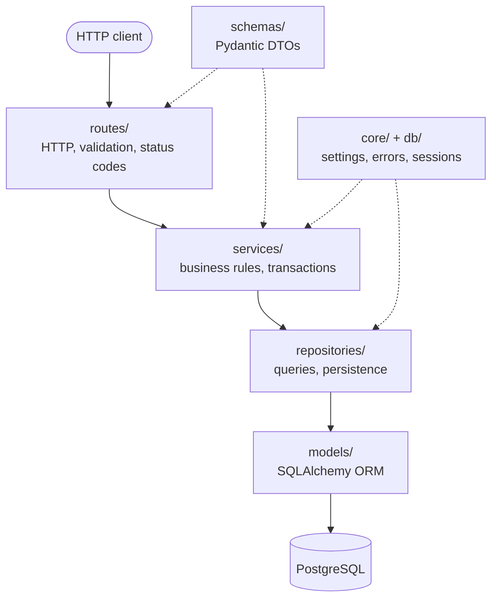
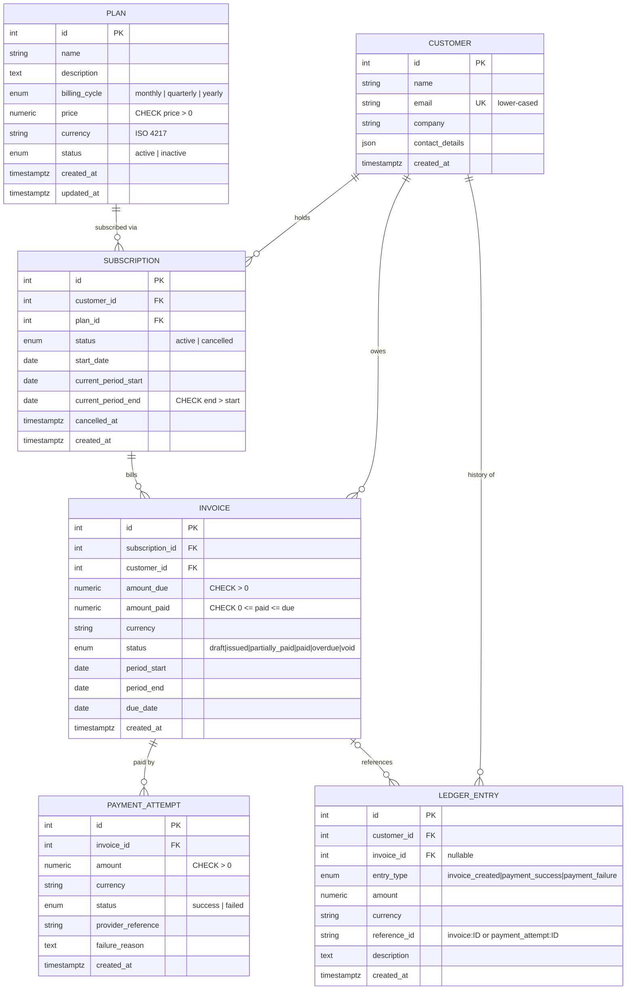
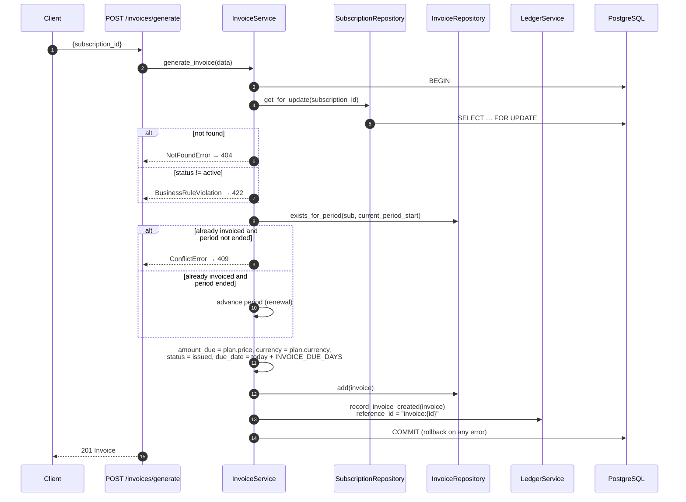
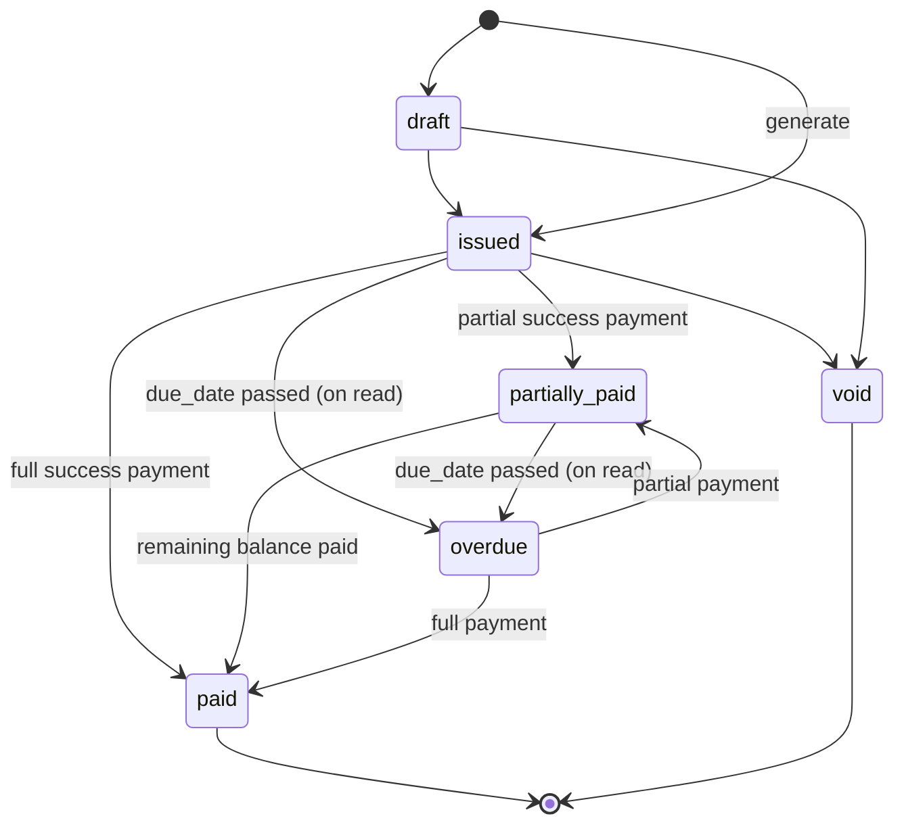
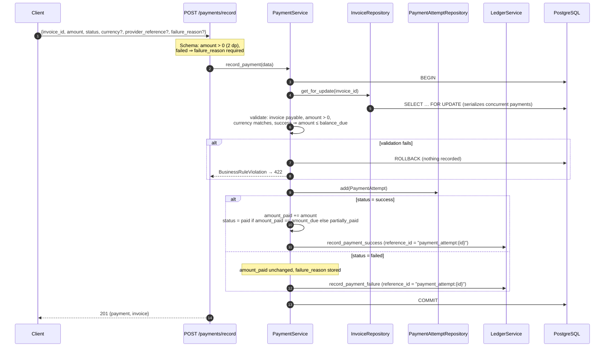

# SubLedger – Low-Level Design

## 1. Architecture Overview

SubLedger uses a layered architecture. Each layer depends only on the layer below it.



| Layer | Responsibility | Must not |
|---|---|---|
| `routes` | Parse/validate requests (Pydantic), call one service method, set the HTTP status, serialize the response | Contain business rules or touch the session |
| `services` | Enforce business rules, orchestrate repositories, own transaction boundaries | Know about HTTP |
| `repositories` | Build queries, add/flush entities, lock rows | Commit, or decide business outcomes |
| `models` | Table mapping, relationships, DB constraints | Contain workflows |
| `schemas` | Request/response contracts, input-shape validation | Query the database |
| `core` / `db` | Settings, clock, domain exceptions and HTTP mapping, engine/session, `transaction()` helper | — |

## 2. Entity Relationship Diagram



### Constraints and indexes

| Table | Constraint / index | Purpose |
|---|---|---|
| `plans` | `ck_plans_price_positive` | Rule 1 at DB level |
| `plans` | `ix_plans_status` | Filter active plans |
| `customers` | `ix_customers_email` (unique) | Rule 2 at DB level |
| `subscriptions` | `uq_subscriptions_active_customer_plan`: partial unique `(customer_id, plan_id) WHERE status='active'` | Rule 4 at DB level; cancelled rows don't block re-subscribing |
| `subscriptions` | `ck_subscriptions_period_order`, FK indexes, `ix_subscriptions_status` | Integrity, lookups |
| `invoices` | `uq_invoices_subscription_period (subscription_id, period_start)` | A billing period is invoiced at most once |
| `invoices` | `ck_invoices_amount_paid_within_due`, `..._non_negative`, `..._amount_due_positive` | Overpayment is impossible even if application code is bypassed |
| `payment_attempts` | `ck_payment_attempts_amount_positive`, `ix_payment_attempts_invoice_id` | Integrity, lookups |
| `ledger_entries` | `ix_ledger_entries_customer_id_created_at`, `ix_ledger_entries_reference_id`, `ix_ledger_entries_invoice_id` | Customer history and traceability queries |
| `ledger_entries` | PostgreSQL triggers `trg_ledger_entries_no_update_delete`, `trg_ledger_entries_no_truncate` | Append-only at the DB level |
| all FKs | `ON DELETE RESTRICT` | Financial records are never cascade-deleted |

Enums are stored as `VARCHAR(32)` with a CHECK constraint (`native_enum=False`). This keeps migrations simple: adding a value doesn't need `ALTER TYPE`. Money is `NUMERIC(12,2)` / `Decimal` throughout, and the API serializes it as a string so no precision is lost.

## 3. Service Responsibility Table

| Service | Responsibilities | Collaborators |
|---|---|---|
| `PlanService` | Create, list and update plans; activate/deactivate via `status`; validate price > 0 | `PlanRepository` |
| `CustomerService` | Create, list and fetch customers; normalize email to lower case; enforce unique email (pre-check, plus mapping a DB `IntegrityError` to 409 if a concurrent insert wins the race) | `CustomerRepository` |
| `SubscriptionService` | Create, list, fetch and cancel subscriptions; reject inactive plans; reject duplicate active subscriptions; compute the first billing period | `SubscriptionRepository`, `CustomerRepository`, `PlanRepository`, `billing_period` |
| `InvoiceService` | Generate an invoice for the current period of an active subscription using the plan's current price; renew elapsed periods; mark past-due invoices `overdue` when read; fetch details | `InvoiceRepository`, `SubscriptionRepository`, `LedgerService` |
| `PaymentService` | Validate and record success/failed attempts; lock the invoice; update `amount_paid` and status for successful attempts only; store failure reasons | `InvoiceRepository`, `PaymentAttemptRepository`, `LedgerService` |
| `LedgerService` | Append `invoice_created`, `payment_success` and `payment_failure` entries with `reference_id`; read a customer's history. Never commits: it joins the caller's transaction | `LedgerRepository`, `CustomerRepository` |

## 4. Repository Responsibility Table

| Repository | Operations |
|---|---|
| `BaseRepository[T]` | `get(id)`, `get_for_update(id)` (`SELECT … FOR UPDATE`), `add(entity)` (add + flush, no commit) |
| `PlanRepository` | `list(status, skip, limit)` |
| `CustomerRepository` | `get_by_email(email)`, `list(skip, limit)` |
| `SubscriptionRepository` | `has_active(customer_id, plan_id)`, `list(customer_id, status, skip, limit)` |
| `InvoiceRepository` | `exists_for_period(subscription_id, period_start)` |
| `PaymentAttemptRepository` | Inherited `add`/`get` |
| `LedgerRepository` | `add`, `list_for_customer(customer_id, skip, limit)`. It deliberately has no update or delete methods |

## 5. Business Rule Ownership

| # | Rule | Owner (primary) | Additional safeguards |
|---|---|---|---|
| 1 | Plan price > 0 | `PlanService._ensure_positive_price` | `PositiveMoney` schema type (early 422); `ck_plans_price_positive` |
| 2 | Customer email unique | `CustomerService.create_customer` | Unique index on `customers.email`; `IntegrityError` mapped to 409 |
| 3 | No subscriptions to inactive plans | `SubscriptionService.create_subscription` | — |
| 4 | One active subscription per customer+plan | `SubscriptionService.create_subscription` | Partial unique index `uq_subscriptions_active_customer_plan` |
| 5 | Invoice uses plan price at generation time | `InvoiceService.generate_invoice` (copies `plan.price` into `amount_due`) | The invoice stores its own amount and currency, so later plan edits can't change it |
| 6 | Successful payment ≤ remaining balance | `PaymentService._validate` | Row lock on the invoice; `ck_invoices_amount_paid_within_due` |
| 7 | Fully paid → `paid` | `PaymentService.record_payment` | — |
| 8 | Partial payment → `partially_paid` | `PaymentService.record_payment` | — |
| 9 | Failed payments don't increase `amount_paid` | `PaymentService.record_payment` (only the success branch mutates the invoice) | — |
| 10 | Ledger append-only and traceable | `LedgerService` / `LedgerRepository` (insert-only API, `reference_id` on every entry) | ORM `before_update`/`before_delete` listeners raise `AppendOnlyViolation`; PostgreSQL triggers |

Input-shape checks live in Pydantic schemas: currency format, required `failure_reason` for failed payments, and unknown fields rejected with `extra="forbid"`.

## 6. Design Patterns

- **Layered architecture / Service Layer.** Business workflows live in services that are independent of HTTP, so tests and other callers can invoke them directly.
- **Repository pattern.** Persistence is behind small repository classes. Services work with intent-revealing methods (`has_active`, `exists_for_period`) rather than raw queries.
- **Dependency injection.** FastAPI `Depends` builds one `Session` per request. `routes/dependencies.py` composes the repositories and services from it, so every service in a request shares the same unit of work. Tests swap the database by overriding `get_db`.
- **Unit of Work via `transaction()`.** `app.db.session.transaction` commits on success and rolls back on any exception. Repositories only flush, so a service can group several writes into one atomic operation. For example, a payment attempt, the invoice update, and the ledger entry commit together.
- **Pessimistic locking.** `get_for_update` locks the subscription (invoice generation, cancellation) or invoice (payments), preventing concurrent double-invoicing or overpayment.
- **Domain exceptions with a central mapping.** Services raise `NotFoundError`, `ConflictError` and `BusinessRuleViolation`. `core/error_handlers.py` maps them to 404/409/422 using a single error envelope.
- **SOLID.** Each class has one reason to change (single responsibility). Services depend on injected collaborators rather than constructing infrastructure (dependency inversion). New behaviour is added through new services or repositories instead of modifying routes (open/closed).

## 7. Invoice Generation Workflow

Billing periods are half-open, `[period_start, period_end)`. Invoices are issued at the start of a period. If the current period has already been invoiced and has ended, the subscription is renewed into the next period and that period is invoiced.



**Invoice status lifecycle**



`draft` and `void` are supported by the model and enum. The generator issues invoices directly, and there is no void endpoint because it's outside the required API. Only `issued`, `partially_paid` and `overdue` invoices accept payments.

## 8. Payment Recording Workflow



## 9. Error Response Format

All errors share one envelope:

```json
{"error": {"code": "business_rule_violation", "message": "Cannot subscribe to an inactive plan.", "details": null}}
```

| Exception | HTTP | `code` |
|---|---|---|
| Pydantic request validation | 422 | `validation_error` (`details` lists field errors) |
| `BusinessRuleViolation` | 422 | `business_rule_violation` |
| `NotFoundError` | 404 | `not_found` |
| `ConflictError` | 409 | `conflict` |
| Unknown route / method | 404 / 405 | `http_error` |
